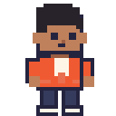
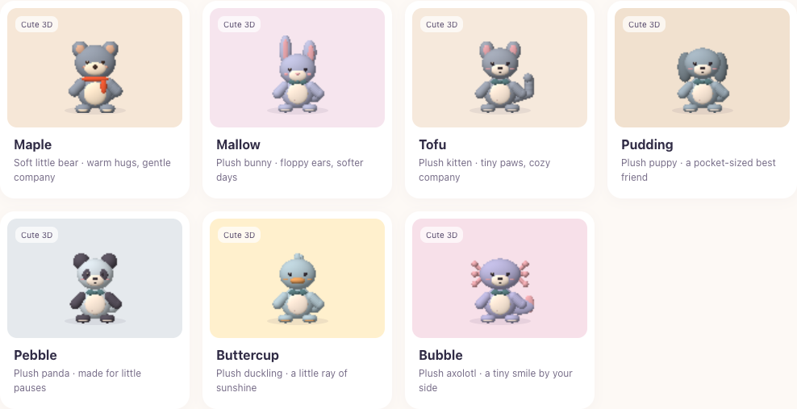
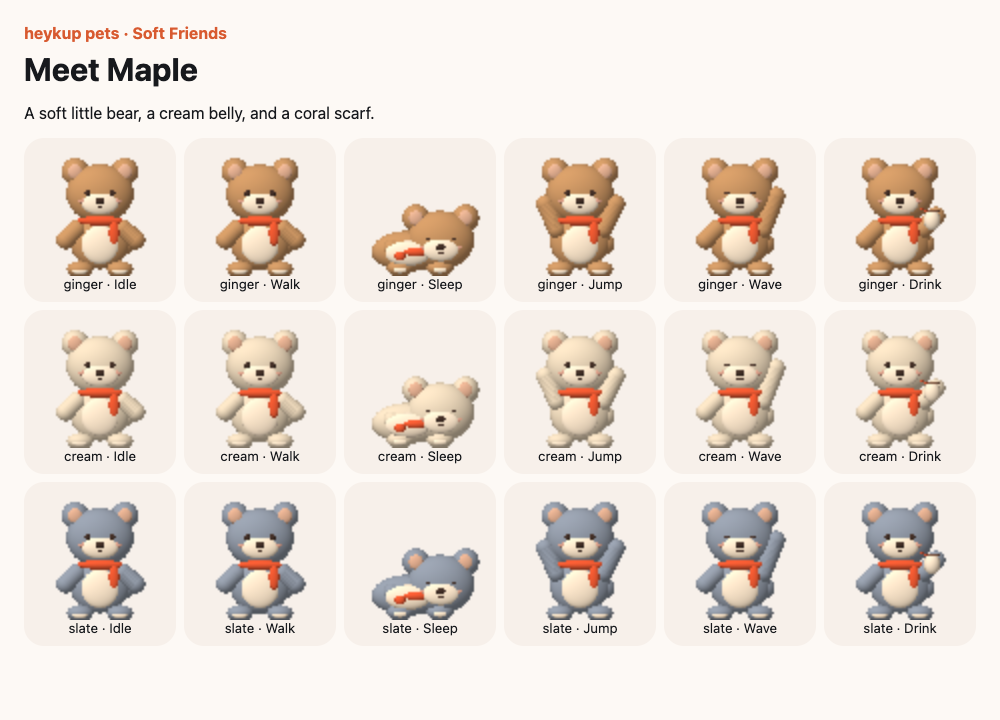
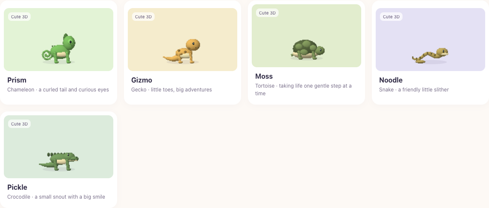
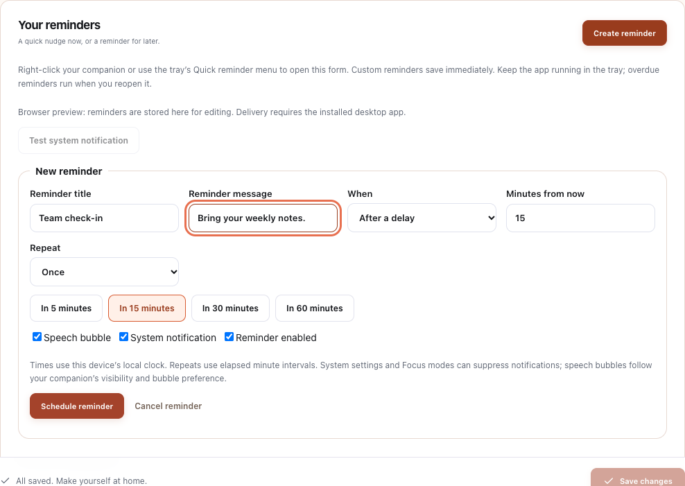

<div align="center">



# heykup pets

**Little companions. Real company.**

An offline desktop companion that brings a little life to your workday.<br>
Pick a friend, make it yours, and let it remind you to look after yourself.

[](LICENSE)
[](https://github.com/ajyghosh/pet/releases/tag/v1.3.0)
[](#get-the-app)
[](https://github.com/ajyghosh/pet/actions/workflows/desktop.yml)

[Features](#features) · [Screenshots](#meet-your-companions) · [Get the app](#get-the-app) · [Quick start](#quick-start) · [Contribute](CONTRIBUTING.md)

</div>


Built with **Tauri 2, React, TypeScript, and Rust**. No account, subscription, paid API, or runtime internet connection required. Original code and bundled character artwork are **MIT licensed**.

> **Stable release:** The current version is **1.3.0**. Download the Windows or Mac installer from [Version 1.3.0](https://github.com/ajyghosh/pet/releases/tag/v1.3.0). See the [validation notes](docs/VALIDATION.md) for the scope of desktop acceptance testing.

## Features

|                                   | What you can do                                                                                                                                                              |
| --------------------------------- | ---------------------------------------------------------------------------------------------------------------------------------------------------------------------------- |
| 🐾 **144 companions**             | Choose animals, people, fantasy characters, pixel art, shaded Cute 3D figures, seven plush animals from Soft Friends, and five Little Reptiles. Each has three color styles. |
| 🎬 **Six animations**             | Watch your companion idle, walk, wave, jump, drink water, and sleep. Try them in a separate preview studio with day/night scenes.                                            |
| 🎨 **Make it yours**              | Change its name, color style, size, and speed.                                                                                                                               |
| 🔔 **Gentle reminders**           | Set water, stretch, and break intervals, plus custom one-off or repeating reminders with speech bubbles and system notifications. Snooze for 15 minutes.                     |
| 🖥️ **Your desktop, your space**   | Choose a display, home side, and walking boundaries. Let your companion roam, stay put, or move only for reminders.                                                          |
| 🫧 **Click-through overlays**     | Transparent areas and speech bubbles let clicks reach the app underneath. Windows uses the actual sprite silhouette for hit testing.                                         |
| 🏠 **Local by design**            | Settings and reminders stay on your device. No analytics, cloud storage, or remote assets at runtime.                                                                        |
| ⚙️ **Tray and menu-bar controls** | Open settings, hide/show, sleep/wake, snooze, and quit. Optionally start at sign-in.                                                                                         |

## Meet your companions

Start with **Alex**, **Nova**, **Sage**, **Mochi**, **Biscuit**, **Ember**, **Clover**, **Bao**, **Pip**, **Sprout**, **Bolt**, or **Cinder**. Explore Everyday Humans, Indian & Kerala, Fantasy & Adventure, and Special Desktop Characters for more company.

<table>
  <tr>
    <td width="50%" valign="top">
      
      <p><strong>Pixel companions</strong><br>Original 32 × 32 artwork with three color styles.</p>
    </td>
    <td width="50%" valign="top">
      
      <p><strong>Cute 3D collections</strong><br>Locally rendered 64 × 64 sprites with soft shading.</p>
    </td>
  </tr>
</table>

### Soft Friends, made for cozy desktops

Meet **Maple** the bear, **Mallow** the bunny, **Tofu** the kitten, **Pudding** the puppy, **Pebble** the panda, **Buttercup** the duckling, and **Bubble** the axolotl. Soft shading, round silhouettes, and tiny details give each one a stuffed-toy feel.

Each friend comes with three color styles and all six animations. Every frame is rendered locally and bundled with the app.





### Little Reptiles

Meet **Prism** the chameleon, **Gizmo** the gecko, **Moss** the tortoise, **Noodle** the snake, and **Pickle** the crocodile. Curled and swaying tails, tiny toes, shell plates, curious eyes, and a continuous snake slither give each one its own character. All five include three color styles and every animation.



In **Walk freely** mode, companions now take varied 18–38 second strolls, look around, greet you, rest, and occasionally take a brief nap. They pause briefly to turn at the boundaries. These everyday routines do not depend on notifications. Hover pauses the routine; moving your pointer away resumes it. Manual Sleep is indefinite; reminders and interactions still work. Only move for reminders keeps its existing behavior.

### A little nudge when you need it

Set regular water, stretch, and break reminders, or schedule your own. Choose **in 5, 15, 30, or 60 minutes**, pick a local date/time, and optionally repeat at a fixed minute interval. Manage up to **100 custom reminders**, with separate speech-bubble and system-notification switches.

Open **Reminders → Create reminder**, right-click your companion, or use **Quick reminder…** from the tray/menu bar.



Keep the desktop app running for delivery. The browser preview lets you edit reminders; desktop notifications and delivery require the installed app. OS notification settings and Focus modes can affect delivery.

## Get the app

Download the installer for your computer from the [latest stable release](https://github.com/ajyghosh/pet/releases/latest), or use a direct link below. Public release downloads do not require GitHub sign-in.

| Computer                        | Download                                                                                                      | Install                                               |
| ------------------------------- | ------------------------------------------------------------------------------------------------------------- | ----------------------------------------------------- |
| Windows 10/11, Intel or AMD x64 | [Windows installer](https://github.com/ajyghosh/pet/releases/download/v1.3.0/heykup-pets_1.3.0_x64-setup.exe) | Run the `*-setup.exe`.                                |
| Mac with Apple Silicon          | [Apple Silicon DMG](https://github.com/ajyghosh/pet/releases/download/v1.3.0/heykup-pets_1.3.0_aarch64.dmg)   | Open the `.dmg` and copy the app to `~/Applications`. |
| Mac with Intel CPU              | [Intel DMG](https://github.com/ajyghosh/pet/releases/download/v1.3.0/heykup-pets_1.3.0_x64.dmg)               | Open the `.dmg` and copy the app to `~/Applications`. |

The release also includes alternate Mac app archives and `SHA256SUMS.txt`. Development artifacts are available from [successful CI runs](https://github.com/ajyghosh/pet/actions/workflows/desktop.yml) and expire after 30 days. You can also [build from source](#run-the-desktop-app).

Windows installers run per user and include the offline WebView2 runtime. Mac builds target macOS 11 or later; launch the app from its final location, outside the DMG. You do not need Node.js or Rust to use a packaged app.

**Signing:** Windows builds are unsigned by default, and Mac builds use an ad-hoc signature without notarization. The OS may display a security prompt. See the [installation guide](docs/USER_GUIDE.md) for platform details.

## Quick start

To explore the settings UI, character gallery and animations in a browser, install **Node.js 24** and run:

```sh
git clone https://github.com/ajyghosh/pet.git
cd pet
npm ci
npm run dev
```

Open **http://localhost:1420**. Use **Open preview** or **Preview studio** to try the animations. Browser settings use local storage and are separate from the desktop app. Desktop placement, tray controls, startup, and notification delivery require a native build.

### Run the desktop app

Install the prerequisites for your platform:

| Platform | Build prerequisites                                                                                                                           |
| -------- | --------------------------------------------------------------------------------------------------------------------------------------------- |
| Both     | Node.js 24 and stable Rust **1.90 or later**, installed through rustup.                                                                       |
| Windows  | Rust MSVC toolchain, Visual Studio 2022 Build Tools with **Desktop development with C++** and the Windows SDK, plus WebView2 for development. |
| macOS    | Xcode Command Line Tools (`xcode-select --install`). Build on a Mac.                                                                          |

Then, from your checkout:

```sh
npm ci
npm run desktop:dev
```

To create an installer for the current platform:

```sh
npm run desktop:build -- -- --locked
```

Local packages appear under `src-tauri/target/release/bundle/`: `nsis/` for Windows, and `macos/` plus `dmg/` for Mac. See the [full build and installation guide](docs/USER_GUIDE.md) for CI targets, startup, permissions, and upgrades from Miso/MiniMates.

## Everyday controls

| Action                                     | Result                                               |
| ------------------------------------------ | ---------------------------------------------------- |
| Click your companion                       | Wake it if sleeping, or greet it with a wave.        |
| Double-click                               | Jump.                                                |
| Hover                                      | Pause movement.                                      |
| Right-click                                | Open a quick reminder.                               |
| Click the Windows tray / Mac menu-bar icon | Open settings.                                       |
| Close settings                             | Keep your companion running in the tray/menu bar.    |
| Save changes / Discard                     | Apply preferences or restore the last saved version. |

On macOS, companion clicks require optional **Accessibility** consent under **Desktop & startup → Enable clicks**. Menu-bar controls work without that permission. Custom reminders save immediately, separately from the appearance Save/Discard flow.

If your companion disappears, select **Desktop & startup → Follow primary display**, save, then use **Show / restart pet**. More troubleshooting is in the [user guide](docs/USER_GUIDE.md).

## Current scope and future work

This version supports **one active companion**. Features below are future work, not promises for a particular release:

- Multiple active companions and encounters between them.
- Dragging, bespoke signature actions, and additional animations.
- Quiet hours, fullscreen auto-hide, and battery/lock optimizations.

The catalog also has **20 reference-only character ideas** that cannot be selected and have no bundled artwork. Read the [beta follow-up](docs/BETA_FIXES.md) for implementation details.

## Contributing

Contributions to code, original artwork, documentation, accessibility, and platform testing are welcome. Start with [**CONTRIBUTING.md**](CONTRIBUTING.md) for setup, checks, and pull request guidance.

Found a problem? [Open an issue](https://github.com/ajyghosh/pet/issues) with reproduction steps, app version, OS, and relevant display details. For a larger feature, open an issue first so the scope can be discussed.

## Project layout

```text
src/                      React settings UI, previews, and Tauri bridge
src/core/                 Character artwork, animation, settings, and reminders
src/components/           Gallery, movement, and reminder controls
src-tauri/src/            Rust windows, input, placement, tray, and persistence
public/characters/        Bundled sprite atlases and character metadata
assets/characters/        Collection catalogs
scripts/                  Artwork generation, notices, and release checks
tests/                    Playwright browser and mocked native-bridge tests
docs/                     Screenshots, guides, and validation checklists
.github/workflows/        Windows and macOS build pipelines
```

## Documentation

- [User and developer guide](docs/USER_GUIDE.md) — installation, reminders, local data, input behavior, architecture, and troubleshooting.
- [Contributing](CONTRIBUTING.md) — development workflow and verification commands.
- [Windows acceptance checklist](docs/WINDOWS_TESTING.md) and [macOS acceptance checklist](docs/MACOS_TESTING.md) — native behavior to verify before distribution.
- [UI audit](docs/UI_AUDIT.md) — layout fixes, regression coverage, and new Soft Friends.
- [Validation notes](docs/VALIDATION.md) — completed checks and remaining testing.
- [Character collection catalog](assets/characters/collections/README.md).

## License

Original code and bundled character artwork are available under the [MIT License](LICENSE). See [third-party notices](THIRD_PARTY_NOTICES.md) for dependency licenses and the separately licensed WebView2 runtime.
