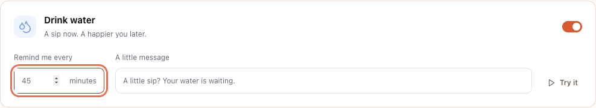

# UI review — 15 October 2026

Reviewed the seven settings screens: My companion, Characters, Preview studio, Reminders, Appearance, Desktop & startup, and About. Browser inspection covered widths of 375, 480, 760, 1000, and 1280 pixels. The native settings window has a configured minimum size of 760 × 600; narrower widths were also checked for browser previews and zoomed layouts.

## Fixes

| Finding                                                                     | Result                                                                                                                                                                             |
| --------------------------------------------------------------------------- | ---------------------------------------------------------------------------------------------------------------------------------------------------------------------------------- |
| Sidebar ornament overlaps copy; caption can be clipped in short windows     | The card uses normal grid flow with a dedicated ornament cell, readable caption, and no flex shrinking.                                                                            |
| Reminder number spinner crowds the minutes suffix; focus outline is clipped | Separate grid columns, enough numeric space, and a visible focus ring around the whole field.                                                                                      |
| Clearing a reminder interval immediately inserts 1                          | An editable draft allows clearing and retyping; blur/Enter commits a whole number from 1 to 240.                                                                                   |
| Controls overflow narrow browser windows                                    | Compact navigation, stacked fields, wrapping toolbars, responsive profile controls, and a wrapping save bar.                                                                       |
| Faint labels and controls                                                   | Darker secondary text, stronger selected colors, and larger labels and action text.                                                                                                |
| Preview pet only responds to the mouse                                      | The pet is a named button with native keyboard activation and a visible focus indicator.                                                                                           |
| Sleeping dashboard pet cannot be clicked directly to wake it                | The portrait is a named wake/greet button. Preview pets also wake when activated. Native greetings already clear indefinite sleep; regression coverage now verifies that behavior. |
| Long names can escape profiles or speech bubbles                            | Profiles wrap long words; preview bubbles wrap and stay within stage bounds.                                                                                                       |
| Gallery and walking-area preview ignore reduced-motion preferences          | Preview timers respect the system preference; the studio pauses when reduced motion becomes enabled. Explicit play remains available in the studio.                                |
| Reference search has no empty state                                         | An explicit status message appears for a search with no reference results.                                                                                                         |

## Character changes

Removed the custom-character library, manual/photo creator entries, preset storage/validation, dynamic custom rendering, native export command, unused styles, and creator specifications. Existing custom selections migrate to Alex while preserving unrelated preferences. Historical audit documents remain marked as superseded where appropriate.

Added six original plush-style animals to Soft Friends: Mallow (bunny), Tofu (kitten), Pudding (puppy), Pebble (panda), Buttercup (duckling), and Bubble (axolotl). Together with Maple, there are seven Soft Friends and 139 bundled companions. Each added animal has three local 64 × 64 atlases with six states, 32 frames per state, and both directions. No runtime network dependency was added.

## Verification

- `npm run check`: 1,421 tests passed; dependency-notice/version checks and production build passed. Atlas tests compare every shipped frame and color against native click-region pixels, including the new animals.
- `cargo test --locked --manifest-path src-tauri/Cargo.toml`: 17 passed on the development Mac, including migration from custom selections and rejection of new custom selections.
- Rust formatting and Clippy with warnings denied passed.
- `npm run test:e2e` with installed Chrome: **27 passed**. Browser regressions cover all screens at desktop and narrow widths, sidebar geometry, interval editing/persistence, creator removal, saved plush selections and atlas loading, wake activation, long names, and reduced motion. See `tests/ui.spec.ts`, `tests/soft-friends.spec.ts`, and the existing browser suites.
- Manual browser screenshots and geometry inspection found no horizontal document overflow or horizontally clipped controls across the seven screens at the five widths above.
- A computed-color review of settings text found no remaining ratios below 4.5:1 against detected solid backgrounds after fixes. Decorative preview artwork, hidden elements, and disabled controls were excluded. This was a targeted check, not a complete accessibility certification; gradients, translucent layers, screen readers, and OS-specific rendering still need human review.
- README screenshots were recaptured from the current app. No installer was published or deployed.

## Release boundary

These results establish source, browser, artwork, and local Rust behavior. They do not establish native compositor behavior, actual notification presentation, macOS Accessibility consent, Windows installation/SmartScreen, sign-in startup, or mixed-DPI multi-monitor behavior for the final packages. Complete the [Windows](WINDOWS_TESTING.md) and [macOS](MACOS_TESTING.md) acceptance checklists on installers built from the exact release commit before public distribution.
