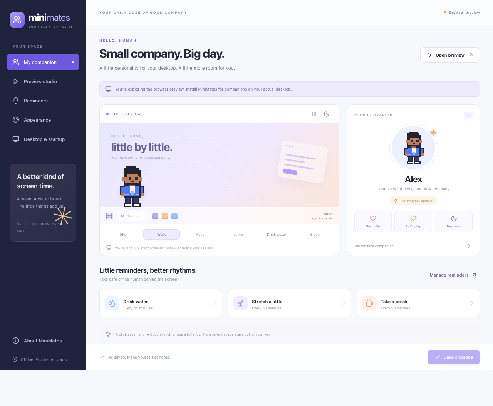
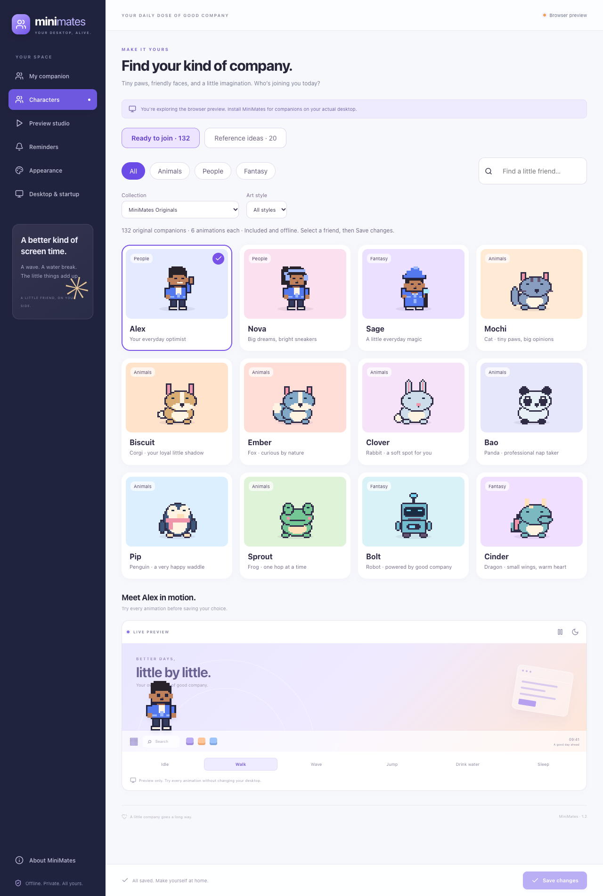
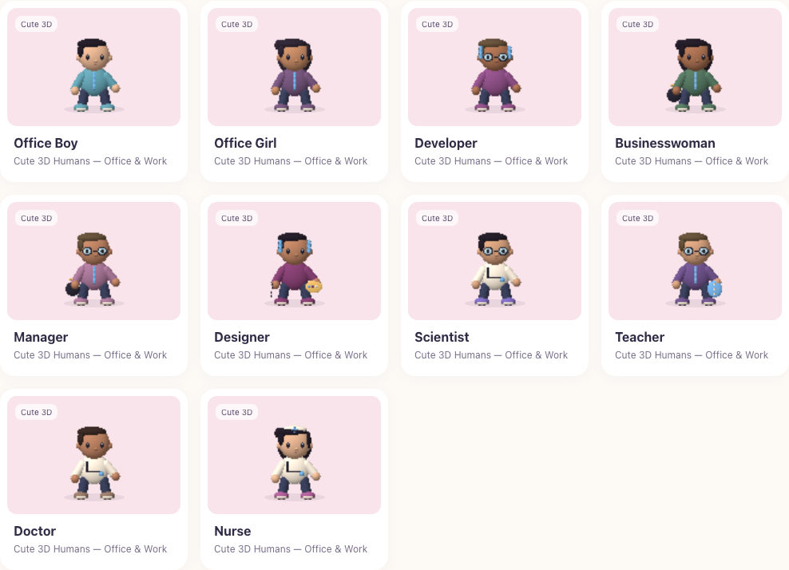

> [Back to the README](../README.md) · Detailed usage, installation, architecture, and troubleshooting.

# heykup pets · little companions, real company

An offline Windows and macOS desktop companion built with **Tauri 2, React, TypeScript, and Rust**. Original pixel artwork and code are MIT licensed. Version **1.3.0** includes everyday companion routines, five Little Reptiles, quick and scheduled reminders, and the heykup brand theme. No account, backend, subscription, paid API, or paid assets.



## Characters and movement

Choose from **144 original animated companions**, each with three color styles and six animation states. The first twelve are: Alex, Nova, Sage the wizard, Mochi the cat, Biscuit the corgi, Ember the fox, Clover the rabbit, Bao the panda, Pip the penguin, Sprout the frog, Bolt the robot, and Cinder the dragon. All PNG frames are included in `public/characters/`; the dependency-free `npm run icons` generator produces them from the same pixel data used for native click regions. No purchased or placeholder assets are used.

The **Soft Friends** collection includes Maple the bear, Mallow the bunny, Tofu the kitten, Pudding the puppy, Pebble the panda, Buttercup the duckling, and Bubble the axolotl. Each has three color styles and six animations. **Maple** is a rounded, clay-style little bear with a cream belly and heykup coral scarf. Choose caramel, cream, or slate fur and preview all six animations. Its shaded sprites are rendered locally, with no model download or graphics runtime required.

All **120 original concepts** from `assets/characters/collections` now have playable artwork: 70 pixel characters across Everyday Humans, Indian & Kerala, Fantasy & Adventure, and Special Desktop Characters; and 50 shaded Cute 3D characters across all five supplied 3D collections. The 20 licensed-character references remain searchable reference-only records with no desktop selection or bundled artwork. The supplied source catalog is preserved; generated manifests and `src/core/ready-characters.json` record the playable assets.

The Cute 3D figures are original articulated ellipsoid models rendered with a depth buffer and studio lighting into 64×64 transparent frames. Pixel characters use 32×32 frames. Model and renderer code is in `src/core/collectionArtwork.ts`; no Blender installation, external models, GPU renderer, or online generation is required. The collection pack’s proposed signature actions are retained as concepts; this release implements the six shared animation states, not separate bespoke dance/signature sequences.

The app now includes a separate **Preview studio** with walk, idle, wave, jump, drink-water and sleep controls, pause/play, and a day/night scene. Previewing never sends live desktop animation commands. Appearance changes preview immediately and apply to the desktop after Save.

Later phases are **not implemented**: multiple active characters, photo intake/conversion, ZIP pack imports, dragging, encounter behavior, full reminder actions/quiet hours, fullscreen auto-hide, and battery/lock optimization. This release does not claim those features or mark native Windows acceptance testing complete.

### Choose your companion and walking area

- Open settings from the Windows tray or Mac menu bar, then **Characters**. Filter by Animals, People, or Fantasy, select a companion, try its animation preview, and **Save changes**. Your custom name is preserved; built-in names follow the character selection.
- **Appearance** changes colors, name, size, and speed. Saving updates the live companion; Discard restores your last saved choice.
- **Desktop & startup → When to walk** offers **Walk freely**, **Stay in place**, and **Only move for reminders**.
- Choose a **Home side** (left or right) and set the walking area's **Left limit** and **Right limit** using percentage sliders. The highlighted strip previews that area on your chosen display. The range stays relative to the work area when resolution or scaling changes. If the range is narrower than the character, it parks at the nearest position that fits the display.
- In reminder-only mode, a reminder causes a short walk inward, a wave, and a return home in about six seconds. Hovering pauses the excursion. A sleeping companion returns to sleep afterward. **Preview reminder movement** simulates this without sending a live reminder; use Reminders → Test for a real desktop reminder after saving.
- Reminder bubbles are now 220 logical pixels wide with smaller text. Short messages use compact bubbles; longer messages expand vertically to remain readable.





## Upgrading from Miso / a companion that never appeared

Quit the older app using its tray menu before installing heykup pets 1.3.0. The app identifier, settings paths, and legacy `Miso` user startup key are retained so upgrades can keep preferences. You can rename a retained companion in Appearance. Startup registration is refreshed to the installed executable when already enabled.

The overlay now starts visibly from Rust while remaining fully click-through until its first valid character region. It selects the correct view using Tauri's native window label, rather than URL query routing. Settings show whether animation frames are arriving and include **Show / restart pet** to safely reposition and reload a stalled companion. Placement failures are displayed in this status area. These changes address startup failure modes; the originally reported invisible Windows pet still needs confirmation with the new installer on the affected machine.

If the companion is missing: open settings, choose **Desktop & startup → Follow primary display**, save, then select **Show / restart pet**. If it remains missing, report the exact desktop-companion status text and your Windows version/display scaling.

## What is included

- A transparent, borderless, non-activating, always-on-top pet window, separate from settings.
- Horizontal walking just above the bottom taskbar or Mac Dock; idle, walking, sleeping, jumping, waving, and drinking-water animation states.
- A Win32 window region derived from the exact opaque 32×32 or 64×64 sprite pixels. Transparent areas are outside the native window, so clicks reach the application underneath. This does not rely on CSS `pointer-events` or cursor polling on Windows.
- macOS AppKit work-area detection and fully click-through overlays, with optional character-only mouse handling after Accessibility consent.
- Completely click-through speech bubbles in their own non-activating window.
- Click to greet, double-click to jump, right-click for a quick reminder; hovering pauses movement.
- Editable water, stretch, and break intervals and messages; individual switches; 15-minute snooze.
- 144 playable characters, collection/style filters, three color styles, name, five sizes, speed, monitor selection, home side, walking-area limits, three movement modes, and speech bubbles.
- Per-monitor work-area and DPI detection, negative desktop coordinates, taskbar edge and auto-hide detection, and hot-plug fallback to the primary display.
- Windows tray / Mac menu-bar controls, single-instance behavior, close-to-tray settings, and optional per-user login startup.
- Validated local JSON settings written atomically. No runtime requests to external services or remote assets; license texts load from the packaged app.
- Per-user Windows NSIS `.exe`, Mac `.app` / `.dmg`, offline WebView2 installer, cross-platform build CI, unit tests, browser tests, and native acceptance checklists.

## Run the preview

Install Node.js 24 LTS (or a compatible modern Node version), then open a terminal in this folder:

```sh
npm ci
npm run dev
```

Open `http://localhost:1420`. The browser preview includes appearance, animations, reminders editing, and local settings. Use **Open preview** or **Preview studio** for a self-contained animation preview. Native desktop placement, startup, and tray require the installed desktop app. The browser preview does not schedule desktop reminders.

## Build and run on Windows

Build prerequisites (needed only by the person compiling the source):

1. Windows 10 or 11, x64, Node.js 24 LTS, and the current stable Rust **MSVC** toolchain from [rustup](https://rustup.rs/).
2. Visual Studio 2022 Build Tools with **Desktop development with C++**, MSVC, and the Windows SDK. The full Visual Studio editor and VS Code are not required.
3. Microsoft Edge WebView2 Runtime for development. Release installers include the offline runtime installer.

From PowerShell in this directory:

```powershell
npm ci
npm run check
cargo test --locked --manifest-path src-tauri/Cargo.toml
npm run desktop:dev
```

The first native launch opens settings and the companion. Subsequent launches restore the pet; click the heykup pets tray icon to open settings. If Windows hides the tray icon in the overflow menu, open that menu to find it.

Build installers:

```powershell
npm run desktop:build -- -- --locked
```

Outputs:

```text
src-tauri/target/release/bundle/nsis/heykup-pets_1.3.0_x64-setup.exe
```

The installer runs in **current-user context**, installs under `%LOCALAPPDATA%`, and does not request administrator elevation. Launch it normally, without “Run as administrator.” The app manifest explicitly uses `asInvoker` with `uiAccess="false"`. heykup pets runs in the signed-in desktop session; it does not install a Windows service or use SYSTEM. Settings live in the user's profile and startup uses HKCU. The default MSI has been removed because it installs machine-wide. Organization policies can still block unapproved applications or runtime installation.

WebView2 supports non-elevated installation; see [Microsoft’s runtime distribution documentation](https://learn.microsoft.com/en-us/microsoft-edge/webview2/concepts/distribution#installing-the-runtime-as-per-machine-or-per-user).

The first build downloads build dependencies, bundling tools, and the offline WebView2 installer. **The resulting app and installer work without an internet connection.** Bundling WebView2 makes the installer substantially larger than the app executable. Installers are unsigned by default; Windows may show an unknown-publisher/SmartScreen prompt. A paid signing certificate is optional and is not required to build or use heykup pets.

## Build and run on Mac

Build on a Mac with Node.js 24, stable Rust, and Apple's Xcode Command Line Tools (`xcode-select --install`). Installing build tools may require an administrator; running the finished app does not require developer tools.

```sh
npm ci
npm run check
cargo test --locked --manifest-path src-tauri/Cargo.toml
npm run desktop:dev
# Package for this Mac's CPU:
npm run desktop:build -- -- --locked
```

Tauri automatically merges `src-tauri/tauri.macos.conf.json`. Outputs are `src-tauri/target/release/bundle/macos/heykup-pets.app` and `src-tauri/target/release/bundle/dmg/*.dmg`. The minimum configured macOS version is 11.0. Builds use a free ad-hoc signature; no Apple Developer subscription or signing secrets are needed. These builds are **not notarized**, so macOS may block a downloaded copy. Follow macOS's per-app Open Anyway flow only for a build you trust; do not disable Gatekeeper globally. Managed Macs may require IT approval.

For installation without writing to system folders, copy `heykup-pets.app` to **`~/Applications`** (create that folder in your home directory if needed). The DMG's Applications shortcut points to `/Applications`; choose your own folder instead for a per-user install. Launch from its final location before enabling startup or granting permissions. Do not run from inside the DMG. Use the menu-bar companion icon → Open heykup pets settings.

Mac desktop placement excludes the Dock and menu bar. Pet clicks are optional: open **Desktop & startup → Enable clicks**, then allow heykup pets in **System Settings → Privacy & Security → Accessibility** and restart if needed. macOS may require administrator approval to change Accessibility permissions. Without permission, walking, reminders, hover pause, settings and menu-bar controls work; clicks go through the entire companion. The app listens only for mouse buttons and does not read keyboard events. Rebuilding or moving an ad-hoc-signed app may require granting consent again.

Startup uses a per-user LaunchAgent under `~/Library/LaunchAgents`. Disable “Meet me at sign-in” before uninstalling, quit using the menu bar, and move heykup-pets.app to Trash. No system daemon is installed.

## Build both platforms with GitHub Actions

[Desktop builds](../.github/workflows/desktop.yml) replaces the Windows-only workflow. It runs on pushes to `main`, `v*` tags, pull requests, and manual dispatch. Each native runner performs frontend tests/build, browser tests, Rust tests/format/lint, and release packaging with the committed lockfiles.

1. Push the source to GitHub.
2. Open **Actions → Desktop builds → Run workflow**, select `main`, and run it (a push to main also starts it automatically).
3. Open the completed run and download the appropriate item under **Artifacts**:

| Artifact                          | Computer                       | Contents                                           |
| --------------------------------- | ------------------------------ | -------------------------------------------------- |
| `heykup-pets-windows-x64`         | Windows 10/11 Intel or AMD x64 | Per-user `*-setup.exe`, including offline WebView2 |
| `heykup-pets-macos-apple-silicon` | Mac with Apple M-series chip   | `.dmg` and `.app.tar.gz`                           |
| `heykup-pets-macos-intel`         | Mac with Intel CPU             | `.dmg` and `.app.tar.gz`                           |

Extract the downloaded artifact ZIP. Use the Windows setup executable or open the Mac DMG; the Mac tar archive is an alternative that preserves the app's executable permissions and symlinks. CI outputs use `src-tauri/target/<target-triple>/release/bundle/`. Artifacts expire after 30 days and are not GitHub Releases. Windows and Mac builds run independently, so one failed platform does not cancel the others.

The workflow requires no signing credentials or paid APIs. Standard [GitHub-hosted runners](https://docs.github.com/en/actions/reference/runners/github-hosted-runners) are free for public repositories; private repositories use your account's Actions allowance. Local builds do not require GitHub. See [Tauri's Mac packaging documentation](https://v2.tauri.app/distribute/dmg/).

## Use the installed app

Run the setup executable, launch **heykup pets** from the Start menu, and save your preferences. After installation you do **not** need Node, Rust, Visual Studio, VS Code, or a terminal.

| Action                                 | Result                                                |
| -------------------------------------- | ----------------------------------------------------- |
| Click the companion                    | Wave and a speech bubble; wakes a sleeping companion  |
| Double-click the companion             | Jump                                                  |
| Hover the companion                    | Pause horizontal movement                             |
| Right-click the companion              | Open a quick reminder                                 |
| Click tray icon                        | Open settings                                         |
| Right-click tray icon                  | Hide/show, sleep, wake, snooze, quit                  |
| Close settings                         | Keep pet running in tray                              |
| Desktop & startup → Meet me at sign-in | Register or remove per-user Windows startup           |
| Save changes                           | Persist preferences and apply them to the desktop pet |

Automatic startup is **off initially**; enabling it launches heykup pets quietly at sign-in. It uses the official Tauri autostart plugin's per-user Windows Run registration. The NSIS uninstaller removes that entry. Settings are retained on uninstall so reinstalls can restore preferences.

## Quick and scheduled reminders

Right-click the companion to open a quick reminder, or choose **Quick reminder…** from the tray/menu bar. On Mac, character clicks require the existing Accessibility consent; the tray entry works without it. You can also open **Reminders → Create reminder** from settings.

Enter a title and message, select **In 5/15/30/60 minutes** or choose a local date/time, and optionally repeat at a minute interval. Speech bubbles and system notifications are both enabled initially and can be selected separately. **Schedule reminder** saves immediately, independently of the appearance Save/Discard bar. You can edit, pause, reschedule or delete up to 100 reminders. Use **Test system notification** to check your OS settings.

Keep heykup pets running in the tray for delivery. It does not start a background service or wake a powered-off/sleeping computer. Overdue reminders are attempted after reopening/resuming; missed repeat intervals coalesce, and simultaneous overdue items produce a summary instead of a burst. One-off attempts are persisted before dispatch to avoid repeating after restart. OS Focus, notification permissions and platform delivery failures can suppress a notification; an attempt is not confirmation that it appeared. If the process exits between persisting an attempt and dispatching it, that attempt is not retried automatically. Speech bubbles follow companion visibility and the global bubbles switch. Snooze also postpones custom reminders while the app runs.

The browser preview supports local reminder editing/persistence; it does not deliver system reminders. Windows notifications need an installed build. Calendar times are stored as timestamps; repeating reminders use fixed minute intervals rather than timezone-aware calendar recurrence.

## Distribution and brand

The displayed brand is **heykup pets** and downloadable bundles use **heykup-pets**. Colours were taken from [heykup.com](https://heykup.com/): coral `#f05a32`, rust `#d85a30`/`#993c1d`, warm cream `#fdf9f5`, and ink `#17191d`. No website, account integration, or remote hosting has been changed. Legacy app identity and settings/startup keys remain compatible with MiniMates/Miso upgrades.

About includes complete third-party notices; installers also carry `LICENSE`, `THIRD_PARTY_NOTICES.md`, and generated `THIRD_PARTY_LICENSES.txt`. `npm run check:release` verifies version agreement, lockfile notice freshness and resource configuration. To regenerate after changing dependencies, install/fetch all three supported targets, then run `npm run notices`. The CI artifact includes `SHA256SUMS.txt` alongside the installer/archive. Release installers are attached to stable tag `v1.3.0`. Continue recording native acceptance results using the platform checklists. See [beta follow-up status](BETA_FIXES.md).

## Reminders and local data

Intervals range from 1 to 240 minutes. Timers use elapsed monotonic time, restart on app launch, and reset only when that reminder's configuration changes. Sleep animation does not disable reminders. Snooze pauses all reminder delivery for 15 minutes. Missed intervals combine into one reminder after suspend or snooze; no queue of overdue bubbles appears. Bubbles last seven seconds. Turning off speech bubbles silences bubble reminders; custom system notifications have their own switches. Hiding the pet from the tray hides bubbles too.

Native settings: `%APPDATA%\com.miso.desktop\settings.json` on Windows; `~/Library/Application Support/com.miso.desktop/settings.json` on Mac. Use the tray to quit before manually editing this file. A malformed file is preserved, defaults are loaded, and settings show a warning; saving intentionally replaces the file. Browser preview settings use localStorage under `miso.settings.v1` and are separate from native settings. No analytics, log upload, or cloud storage is implemented. Custom reminders live beside settings in `reminders.json`.

## Monitor and input behavior

**Windows:** `EnumDisplayMonitors` and `GetMonitorInfoW` supply each monitor's physical bounds and available work area, including areas reserved by app bars. Explorer taskbar windows identify the taskbar edge; `ABM_GETAUTOHIDEBAREX` detects auto-hidden taskbars per display. Physical coordinates and monitor DPI are used for placement and region construction. Display layout is refreshed every two seconds, including after unlock or monitor hot-plug. Selecting a missing monitor falls back to the primary display without deleting the preference.

On the usual bottom taskbar, the companion's feet sit four logical pixels above the work-area bottom. With top, left, or right taskbars, it still walks **horizontally at the bottom of the available work area**, away from the docked bar. On auto-hide taskbars, an extra reveal margin leaves the screen edge accessible. Expanding an auto-hidden taskbar can temporarily cover the pet; heykup pets does not force Explorer's taskbar open or closed.

The sprite's native hit region is a union of its opaque pixel spans, rebuilt only when the silhouette or scale changes. Speech bubbles never accept input. If a region or placement operation fails, heykup pets hides the overlay and reports the problem in settings. Settings are a normal interactive window. Secure desktops (UAC, lock screen), exclusive fullscreen applications, and other topmost windows can cover the companion; Windows does not guarantee a normal app can appear above those surfaces.

**Mac:** `NSScreen.frame` / `visibleFrame` provide screen bounds and usable areas in global points. Backing scale is kept separate, so mixed Retina/non-Retina layouts and negative coordinates do not multiply screen origins incorrectly. Screens are refreshed every two seconds. Side Dock layouts keep the companion along the bottom of the remaining area; auto-hidden Docks leave a reveal margin. Both overlays always ignore mouse events. With permission, a mouse-only CoreGraphics event filter consumes clicks that start on opaque sprite spans. Hidden or stale frames fail open. Fullscreen Spaces, Stage Manager, and other floating windows need desktop acceptance testing; the app cannot promise visibility above every system surface.

## Tests

```powershell
npm run check
npx playwright install chromium
npm run test:e2e
cargo fmt --manifest-path src-tauri/Cargo.toml --check
cargo test --locked --manifest-path src-tauri/Cargo.toml
cargo clippy --locked --manifest-path src-tauri/Cargo.toml -- -D warnings
```

TypeScript tests cover motion boundaries, jump timing, sleep/wake, resume clamping, reminder deadlines/snooze/coalescing, settings normalization, and exact equality between the shipped PNG pixels and native hit spans across all frames, outfits, and directions. Browser tests cover persistence, discard, preview play/pause and all six states, small-window layout, and absence of remote asset requests. Mocked native-bridge tests cover window-label routing without queries, frame submission, failure reporting, recovery controls, and preview isolation; these are not OS compositor tests. Rust tests cover atomic persistence, corrupt-file handling, input validation, and negative-coordinate/DPI placement, AppKit coordinate conversion, and character-only click routing (including stale frames and unrelated drags).

Browser and logic tests cannot prove native compositor or taskbar/Dock behavior. Run the [Windows](WINDOWS_TESTING.md) or [Mac](MACOS_TESTING.md) acceptance checklist before distributing an installer. See [validation notes](VALIDATION.md) for checks actually performed in the development environment.

## Source map

```text
src/App.tsx                 Settings UI and browser preview
src/PetWindow.tsx           Native pet and bubble webviews, timers and interaction
src/core/                  Original character pixel artwork, motion, settings, reminders, tests
public/characters/         Original PNG animation atlases and Alex metadata
src/components/CompanionPreview.tsx  Independent interactive preview studio
src/api.ts                 Small typed Tauri bridge / local browser adapter
src-tauri/src/lib.rs        Native commands, windows, tray, startup, validation
src-tauri/src/platform.rs   Win32 taskbar/monitor enumeration and exact window region
src-tauri/src/platform_macos.rs  AppKit screens, windows, optional mouse-only event filter
src-tauri/src/hit_test.rs   Pure character hit testing and click routing
src-tauri/src/geometry.rs   Windows pixel / Mac point placement
src-tauri/src/settings.rs   Validated atomic JSON persistence
src-tauri/tauri.conf.json   CSP, per-user NSIS, offline runtime packaging
src-tauri/tauri.macos.conf.json  Mac app/DMG, ad-hoc signing
scripts/generate-icons.mjs  Reproducible original PNG/ICO/ICNS generation
.github/workflows/          Windows + Intel/Apple Silicon Mac builds
```

No general shell, filesystem, HTTP, or autostart commands are exposed directly to the frontend. Rust commands restrict caller window labels and validate inputs. The application has a local-only content security policy. The only frontend capability is listening to app events.

Technical references: [Tauri Windows installers](https://v2.tauri.app/distribute/windows-installer/), [Tauri autostart](https://v2.tauri.app/plugin/autostart/), [Tauri tray](https://v2.tauri.app/learn/system-tray/), [Microsoft MONITORINFO](https://learn.microsoft.com/en-us/windows/win32/api/winuser/ns-winuser-monitorinfo), [Microsoft SetWindowRgn](https://learn.microsoft.com/en-us/windows/win32/api/winuser/nf-winuser-setwindowrgn), [Microsoft SHAppBarMessage](https://learn.microsoft.com/en-us/windows/win32/api/shellapi/nf-shellapi-shappbarmessage).

License: [MIT](../LICENSE). See [third-party notices](../THIRD_PARTY_NOTICES.md) for open-source dependencies and the free proprietary WebView2 prerequisite.

### Hosting alongside heykup.com

Host installer archives and `SHA256SUMS.txt` under a download path such as `/downloads/heykup-pets/` and link them from the existing heykup website. The desktop app does not need a hosted backend. Existing heykup account or office-planning data is not connected to pets.

If you also want the browser preview under `/pets/`, run `npm run build -- --base=/pets/` and serve that `dist/` under `/pets/`. Sprite and notice URLs follow that base path. Run the normal `npm run build` again before a native package so its assets use the desktop app root. No DNS, hosting or existing-site changes are performed by these commands.

## Everyday routines and Little Reptiles

Walk freely now mixes 18–38 second strolls with short rests, looking around, occasional greetings, and brief naps that end on their own. Boundaries bring a short pause before walking in the opposite direction. The old fixed eleven-second stop has been removed. Hovering pauses walking and the everyday routine; move the pointer away to continue. Stay in place and Only move for reminders still respect their chosen area. Manual Sleep is indefinite; reminders and interactions still work.

The Little Reptiles collection adds Prism (chameleon), Gizmo (gecko), Moss (tortoise), Noodle (snake), and Pickle (crocodile), with all three color styles and six animation states. Choose a reptile in Characters and save to use it on your desktop.
